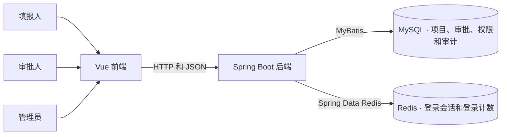
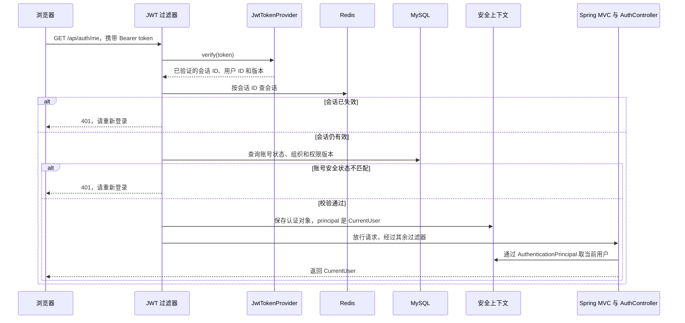

# Java 后端架构与学习进度

更新于 2026-11-05 · 主线项目 `project-approval-demo`

## 先看这里

- **项目做什么**。填报人创建项目材料、提交、撤回或在驳回后修改重提。审批人按组织层级处理任务，系统保留各次提交的材料快照和审批记录。管理员管理用户、角色、权限和会话，并查看审计日志。 [项目功能与范围][readme]
- **系统怎么跑**。Vue 3 / Vite 前端通过 HTTP 调用 Spring Boot 后端。MySQL 持久化业务数据，Redis 保存登录会话和登录计数。Java 后端由 Maven 构建，通过 MyBatis 访问数据库，通过 Spring Security 接入认证和授权。 [项目源码架构][arch] · [后端依赖][pom]
- **目前学到哪**。此前在若依论坛练习里读过基本 CRUD，能顺着代码讲分层。审批项目的登录、登录次数限制、会话有效期和 AOP 审计已带读。当前在追 `@AuthenticationPrincipal` 读取了什么，以及为什么可以顺着它找到 `setAuthentication`。 [源码学习记录与续学断点](Java后端源码学习记录.md#续学断点)
- **接下来学什么**。先用断点验证一次正常登录态和一次失效会话。接着独立练「我的项目」分页查询，再看「待审任务」的多表与可见范围，最后练提交审批的多表事务、并发和幂等。详见[后续练习](#后续练习)。

## 一、通用后端架构地图

先看系统边界、角色和运行组件，再看应用内部的模块和代码。学一个主题时，先问它解决什么问题、谁提供能力，再找项目中的使用位置，用一次请求或一组数据验证。代码职责可借鉴 C4 的逐层放大方式，运行场景、部署和横切能力可参考 arc42。 [C4 图的层次][c4] · [arc42 架构文档结构][arc42]

这里的**代码分层**描述一个后端进程内怎么分工，**运行结构**描述前端、应用和数据库等组件怎么连接。Service 接口和实现属于同一层。认证、异常处理、事务、审计会影响多条业务链路，可以在相应主题下统一学习。 [逻辑分层与部署层][tiers] · [本项目的分层职责][arch]

### 1. 系统边界与代码组织

| 子主题 | 解决什么问题 | 在当前项目里怎么找 |
|---|---|---|
| 系统边界与运行组件 | 确定谁使用系统、应用需要哪些外部依赖 | 已体现。填报人、审批人、管理员使用 Vue 前端，后端依赖 MySQL 和 Redis。看下文的[系统结构](#系统结构) |
| 业务模块 | 按职责划分变化范围 | 已体现。认证与会话、填报与审批、用户权限管理各有入口。 [接口清单][api] |
| 代码分层与数据对象 | Controller 接请求，Service 落业务规则，Mapper 负责持久化访问 | 已体现。请求和响应对象在 `dto`，数据库映射及业务数据对象在 `domain` 等包。以 `ProjectController.mine` → `ProjectServiceImpl.mine` → `ProjectMapper` 追一遍。 [项目接口][project-controller] · [项目服务][project-service] · [项目 Mapper][project-mapper] |

### 2. Java 与 Spring 运行基础

| 子主题 | 解决什么问题 | 在当前项目里怎么找 |
|---|---|---|
| JDK、JVM 与 Maven | 区分编译、运行、依赖管理和打包 | 已体现。项目使用 Java 17，Maven 的 `pom.xml` 声明依赖和构建插件。 [pom.xml][pom] |
| 读懂业务 Java | 理解接口与实现、record、泛型、集合、异常、lambda 和 Stream | 已体现。登录用户是 `CurrentUser`，列表返回 `ApiResponse<PageResult<ProjectView>>`，JWT 过滤器将权限字符串转换成授权对象。 [CurrentUser][current-user] · [项目接口][project-controller] · [JWT 过滤器][jwt-filter] |
| Boot 启动、Bean 与依赖注入 | 找到启动入口，知道对象由谁创建、何时注入、配置从哪读 | 已体现。先看 `ApprovalApplication`，再看 `ProjectController` 构造器、`SecurityConfig` 的 Bean 定义和 `SecurityProperties`。 [启动类][application] · [安全配置][security-config] · [配置属性][security-properties] |
| AOP 与代理 | 在方法调用前后插入审计、事务等行为 | 已体现。项目用 `@AuditAction` 标记操作，由 `AuditAspect` 收集结果。事务也涉及 Spring 代理，后续结合审批写入学它的边界。 [审计切面][audit-aspect] · [项目服务][project-service] |

### 3. HTTP 请求与 API

| 子主题 | 解决什么问题 | 在当前项目里怎么找 |
|---|---|---|
| 网络入口 | 确认请求怎样到达应用，区分域名、端口、TLS 和代理 | 部分体现。先看本地访问地址、前后端端口和浏览器请求。DNS、TLS 终止和反向代理随部署场景再学。 [本地启动说明][readme] |
| HTTP、路由与参数来源 | 区分请求方法、路径、查询参数、请求头和请求体 | 已体现。对照 `GET /api/projects?status=DRAFT`、`GET /api/projects/{id}` 和 `POST /api/auth/login`。 [项目接口][project-controller] · [登录接口][auth-controller] |
| 参数绑定、JSON 与校验 | 把外部输入变成 Java 对象，拒绝不符合契约的值 | 已体现。`@RequestParam`、`@PathVariable`、`@RequestBody` 对应不同来源，校验注解约束输入。可先追 JSON 如何进入 `LoginRequest`，再看返回值如何序列化。 [登录接口][auth-controller] · [登录请求对象][login-request] · [Spring MVC][spring-mvc] |
| 错误与响应 | 给调用方可判断的结果，并能定位错误发生在哪一步 | 已体现。Controller / Service 异常由 `GlobalExceptionHandler` 处理，认证阶段的错误由安全层写响应。 [全局异常处理][errors] · [JWT 过滤器][jwt-filter] |

### 4. 身份与权限

| 子主题 | 解决什么问题 | 在当前项目里怎么找 |
|---|---|---|
| 登录与凭证签发 | 校验密码和账号状态，限制重复尝试，为后续请求建立登录态 | 已体现。`AuthServiceImpl.login` 组织登录流程，`LoginAttemptService` 分别按 IP 和账号记录次数。 [登录服务][auth-service] · [登录计数][login-attempts] |
| JWT、Redis 会话与当前用户 | 确认请求来自有效会话，给业务代码提供当前操作者 | 已体现。`JwtTokenProvider.verify` 处理 JWT 签名及声明校验，过滤器联合检查 Redis 会话和数据库中的账号状态。空闲续期和绝对有效期可从 `RedisSessionService.touch` 入手。 [JWT 实现][jwt-provider] · [Redis 会话][redis-sessions] · [认证时序](#认证时序) |
| 功能权限与数据权限 | 分别判断「能不能调用接口」和「能操作哪条记录」 | 已体现。用 `@PreAuthorize` 判断功能权限，在 SQL 和 Service 中限制项目归属、审批人及可见轮次。 [项目接口][project-controller] · [项目查询 SQL][project-xml] · [项目服务][project-service] |
| 接口安全边界 | 限制越权、输入注入和敏感信息泄露 | 部分体现。从当前用户的数据范围、请求校验、MyBatis 参数绑定和密码字段的序列化边界入手。浏览器跨域、CSRF 和密钥管理另学。 [项目查询 SQL][project-xml] · [用户对象][app-user] · [安全配置][security-config] |
| 第三方身份与单点登录 | 接入外部身份提供方，统一多个应用的登录 | 当前项目未体现。地图保留 OAuth 2.0、OIDC、SSO，先作为后续主题。 |

### 5. 业务规则与数据

| 子主题 | 解决什么问题 | 在当前项目里怎么找 |
|---|---|---|
| 数据建模、关系与约束 | 确定一行代表什么、怎样关联、哪些重复或缺失必须阻止 | 已体现。项目主记录关联多次提交，审批步骤对应候选人。先辨认各表的主键、关联列和唯一约束。 [建表脚本][schema] |
| 数据源、JDBC 与连接池 | 理解一次 SQL 如何拿到数据库连接，以及连接为何复用 | 已体现。项目依赖 Spring JDBC 和 MySQL 驱动，数据库连接从 `spring.datasource` 配置。练习时可观察一次查询如何从 Mapper 到数据库。 [后端依赖][pom] · [连接配置说明][readme] |
| 数据访问与查询 | 在 Java 和 SQL 之间传参、映射结果，完成筛选、关联和分页 | 已体现。`ProjectMapper` 的接口方法对应 XML 中的语句 ID。项目列表用 `selectMine` 取当前页，用 `countMine` 取总数。数据库索引与执行计划可用现有 SQL 另做实验。 [Mapper 接口][project-mapper] · [Mapper XML][project-xml] |
| 业务规则与状态流转 | 管住谁可以做操作、什么状态可以变、操作以后写哪些数据 | 已体现。提交、审核、撤回有各自入口，审批路径规划由 `OrganizationApprovalRoutePlanner` 承担。 [项目服务][project-service] · [路径规划器][route-planner] |
| 事务、并发与幂等 | 避免多表只写了一半、两个人互相覆盖或重试造成重复提交 | 已体现。提交与审批使用事务，结合项目行锁、版本检查、提交回执和数据库约束。真实回滚与并发结果需要运行场景验证。 [项目服务][project-service] · [建表脚本][schema] · [手动验收清单][acceptance] |

### 6. 中间件与外部集成

| 子主题 | 解决什么问题 | 在当前项目里怎么找 |
|---|---|---|
| Redis 与缓存 | 会话需要过期和撤销，业务缓存用于减少对数据源的重复读取 | 部分体现。已有 Redis 会话和登录计数，未见业务查询缓存。缓存命中、失效和数据一致性另设学习条目。 [Redis 会话][redis-sessions] · [登录计数][login-attempts] |
| 事件、定时任务和消息队列 | 在主流程之外处理后续动作，或让系统之间异步协作 | 部分体现。已有事务提交后的应用内会话撤销事件。定时调度、独立消息代理、消息重试与死信留作后续主题。 [会话撤销监听器][revocation] |
| 文件、第三方接口与网络失败 | 接收文件或调用外部服务，并处理超时、重试和失败 | 当前项目的材料是文本。文件上传、对象存储、外部 HTTP 调用和回调可分别保留在路线图里。 [项目范围][readme] |

### 7. 测试、部署与运维

| 子主题 | 解决什么问题 | 在当前项目里怎么找 |
|---|---|---|
| 测试与验收 | 可重复验证接口、数据库、权限及失败场景 | 部分体现。已有源码与构建检查记录、手动验收清单。单元测试、集成测试、自动化验收分别学习，运行结果按实际证据填写。 [构建检查记录][verification] · [手动验收清单][acceptance] |
| 日志、审计、健康检查与观测 | 分清业务留痕、故障排查和运行状态监控 | 部分体现。已有请求 ID、应用日志、审计日志和基础健康检查。指标、告警和分布式追踪留作扩展。 [请求 ID 过滤器][trace-filter] · [审计切面][audit-aspect] · [项目日志说明][arch] · [OpenTelemetry 信号分类][otel] |
| 环境配置、迁移与交付 | 在不同环境启动服务，安全地部署代码与变更数据库 | 部分体现。已有本地启动步骤、环境配置、初始化和增量升级脚本。环境变量与密钥管理、发布流水线、备份恢复和回滚作为后续方向。 [启动与升级说明][readme] · [增量升级脚本][upgrade] |

### 8. 架构演进

当前后端作为一个 Spring Boot 应用运行，可以用它练习分层和业务模块边界。之后再比较模块化单体、Web 与后台 Worker、微服务、事件驱动，以及网关、反向代理、负载均衡、服务超时与重试如何影响部署和故障处理。需要掌握每种做法解决的问题、增加的成本和适用条件。当前项目未体现微服务拆分、独立网关或容器编排。 [常见架构风格][styles]

## 二、项目实例与学习进度

### 系统结构

读任意业务接口时，可以从前端发出的 URL 反查 Controller，找到调用的 Service，再追 Mapper/XML 或 Redis。遇到参数或对象时，先判断它来自 HTTP、Spring 注入、安全上下文，还是一次数据库查询。

### 认证时序

以已经登录后发出的 `GET /api/auth/me` 为例。登录时后端签发 JWT 并保存 Redis 会话。后续请求带上 `Authorization: Bearer …`。过滤器执行认证后，Spring MVC 才会调用受保护接口。下图从 JWT 校验通过的分支往下追，其他输入见图下的结果表。 [登录服务][auth-service] · [安全配置][security-config] · [认证过滤器][jwt-filter] · [当前用户接口][auth-controller]

可以按下面的顺序读四个入口。

1. `SecurityConfig.securityFilterChain`。找到 `addFilterBefore`。这是应用配置过滤器顺序的位置。 [SecurityConfig.java][security-config]
2. `JwtAuthenticationFilter.doFilterInternal`。看如何从请求头取得 token，怎样用它查会话和账号状态，以及哪个分支会直接返回。 [JwtAuthenticationFilter.java][jwt-filter]
3. `JwtTokenProvider.verify`。确认输入是 token 字符串，输出包含会话 ID、用户 ID、权限版本和过期时间。这里先读项目对 JJWT 的调用和错误结果。 [JwtTokenProvider.java][jwt-provider]
4. `AuthController.me`。定位 `@AuthenticationPrincipal CurrentUser user`。过滤器写入的认证对象里包含这个 principal，Spring 为 Controller 参数取值。 [AuthController.java][auth-controller] · [Spring Security Servlet 架构][spring-security]

| 请求情况 | 可以预测的结果 |
|---|---|
| 带有效 JWT，且会话与账号状态有效 | 会走到 `me()`，可以在断点看到 `CurrentUser` |
| JWT 仍有效，Redis 会话已撤销 | 过滤器返回 401，`me()` 断点不会命中 |
| 没带 `Authorization` 请求头 | 过滤器继续执行后续链路，受保护的 `/me` 由 Spring Security 的认证入口返回 401 |
| 请求头格式错误，或 JWT 无效、过期 | 过滤器直接返回 401 |

### 学习台账

项目实现与个人掌握分别记录。**项目状态**使用「已实现／部分体现／未体现／待核实」。**个人进度**使用「未展开／带读中或已带读／能独立解释和预测／能独立验证或修改」。有源码、运行记录、个人练习三种不同证据，更新时写清证据来自哪里。

| 学习条目 | 项目状态 | 个人进度与依据 | 最近要补的证据 |
|---|---|---|---|
| 若依论坛 CRUD 与分层 | 论坛练习已有实现 | 汇报中能顺着编辑请求讲 Controller、Service、Mapper 和 SQL 的分工，有练习记录 | 用审批项目做一次独立查询，验证能否把经验迁移过去。 [论坛代码阅读指南][forum] |
| 登录、失败计数与会话有效期 | 已实现 | 已带读，能复述账号失败次数和 IP 限流的区别，讨论过空闲时间与绝对上限 | 对照一个会话的 Redis TTL 和 JWT `exp`，解释哪个先失效。 [登录服务][auth-service] · [Redis 会话][redis-sessions] |
| 携带 token 的请求与当前用户 | 已实现 | 带读中。能复述过滤器先于 Controller，正在追参数解析器如何读取安全上下文、谁写入认证结果 | 对照有效会话和失效会话的断点与响应。 [当前用户如何进入参数](Java后端源码学习记录.md#当前用户如何进入参数) |
| AOP 审计与请求日志 | 已实现 | 审计切面和 `@Around` 已带读，独立跟踪待验证 | 跑一次触发审计的操作，分别找到业务结果、请求日志和审计记录。 [审计切面][audit-aspect] |
| 项目列表、多表查询与数据权限 | 已实现 | 单表 CRUD 有基础，审批项目的多表查询和按轮次可见范围待独立练习 | 独立写核心 SQL，对照两个账号的列表结果和分页总数。 [项目查询 SQL][project-xml] |
| 提交审批、回滚、并发和幂等 | 已实现 | 待系统学习，尚无独立场景验证记录 | 在练习环境验证失败回滚、同一请求重发以及两人同时审批。 [项目服务][project-service] · [手动验收清单][acceptance] |
| Redis 业务缓存、淘汰与持久化 | 本项目体现了会话和计数，业务查询缓存未体现 | 已接触通用概念。还需分别说明会话 TTL、缓存淘汰、持久化恢复解决什么问题 | 用三个具体场景分别解释删除数据、内存压力和进程重启后的行为 |

个人进度基于《学习后端_new》《学习后端_new_辅助理解其他概念》《后端功能开发学习》《汇报后端进度演习》的讨论。项目的已有验证记录覆盖源码与构建检查，真实业务、权限、并发和迁移结果需另附本机运行证据。 [项目验证记录][verification]

目前还没有个人实操记录的主题可以分两组。近期要补的是独立写多表分页查询、验证数据权限、观察事务回滚、并发冲突和幂等。后续按架构地图展开的是自动化测试、索引与执行计划、业务缓存、异步消息、部署与回滚、指标与追踪、分布式架构。每组都在有实际证据时逐条更新。

### 后续练习

1. **收口认证。** 断点设在过滤器写入安全上下文的地方和 `AuthController.me`。用未过期的 JWT 请求 `GET /api/auth/me`，通过 `POST /api/auth/logout` 撤销这次测试会话，再用原 JWT 发同一个请求。通过标准是能独立说出谁提供 `CurrentUser`、失败请求在哪返回。 [认证接口][auth-controller] · [认证过滤器][jwt-filter]
2. **写「我的项目」查询。** 带着 `GET /api/projects?page=1&size=10&status=DRAFT` 去读 `ProjectController.mine`、`ProjectServiceImpl.mine`、`ProjectMapper.xml`。然后关掉现有 SQL，自己写出当前用户、软删除、状态、排序和分页条件。用两个账号验证结果，并确认列表和总数使用同一套筛选条件。 [项目接口][project-controller] · [项目服务][project-service] · [项目查询 SQL][project-xml]
3. **看「待审任务」为什么是多表题。** 先写清一行表示一次提交轮次，再追项目、提交快照、审批步骤、候选人之间的关系。用「同一项目提交两轮，某人只参与一轮」验证其可见范围。学到这里时补审批表关系图。 [项目查询 SQL][project-xml] · [建表脚本][schema]
4. **用提交审批学习事务和幂等。** 从 `ProjectServiceImpl.submit` 追项目锁定、归属校验和已有提交回执。命中同参回执会返回原轮次，新提交才继续检查版本和业务状态、写快照与审批数据。在练习环境验证失败回滚、同一请求重发和多人同时审批，再补状态流转图。 [项目服务][project-service] · [手动验收清单][acceptance]

### 怎么持续更新

- 项目新增或改动功能时，更新对应架构条目的项目状态、代码入口和运行验证。源码与旧说明有差异时，记录当前源码所表现的行为。
- 每次学习只更新有新证据的条目。记下能复述什么、独立跑了哪个请求、结果如何、下一次从哪接着看。把最新断点同步到顶部速览。
- 通用概念即使暂时没有项目实例，也留在地图中。以后有了合适的练习，再补上项目、入口和验证方法。旧若依练习的成果继续按各自项目记录。 [30 天学习清单与每日记录模板][checklist]

[readme]: ruoyi/project-approval-demo/README.md
[arch]: ruoyi/project-approval-demo/docs/ARCHITECTURE.md
[api]: ruoyi/project-approval-demo/docs/API.md
[acceptance]: ruoyi/project-approval-demo/docs/MANUAL_ACCEPTANCE.md
[verification]: ruoyi/project-approval-demo/docs/VERIFICATION.md
[pom]: ruoyi/project-approval-demo/backend/pom.xml
[application]: ruoyi/project-approval-demo/backend/src/main/java/com/learning/approval/ApprovalApplication.java
[security-properties]: ruoyi/project-approval-demo/backend/src/main/java/com/learning/approval/config/SecurityProperties.java
[security-config]: ruoyi/project-approval-demo/backend/src/main/java/com/learning/approval/config/SecurityConfig.java
[auth-controller]: ruoyi/project-approval-demo/backend/src/main/java/com/learning/approval/controller/AuthController.java
[project-controller]: ruoyi/project-approval-demo/backend/src/main/java/com/learning/approval/controller/ProjectController.java
[login-request]: ruoyi/project-approval-demo/backend/src/main/java/com/learning/approval/dto/request/LoginRequest.java
[auth-service]: ruoyi/project-approval-demo/backend/src/main/java/com/learning/approval/service/impl/AuthServiceImpl.java
[project-service]: ruoyi/project-approval-demo/backend/src/main/java/com/learning/approval/service/impl/ProjectServiceImpl.java
[route-planner]: ruoyi/project-approval-demo/backend/src/main/java/com/learning/approval/service/impl/OrganizationApprovalRoutePlanner.java
[project-mapper]: ruoyi/project-approval-demo/backend/src/main/java/com/learning/approval/mapper/ProjectMapper.java
[project-xml]: ruoyi/project-approval-demo/backend/src/main/resources/mapper/ProjectMapper.xml
[errors]: ruoyi/project-approval-demo/backend/src/main/java/com/learning/approval/exception/GlobalExceptionHandler.java
[current-user]: ruoyi/project-approval-demo/backend/src/main/java/com/learning/approval/security/CurrentUser.java
[app-user]: ruoyi/project-approval-demo/backend/src/main/java/com/learning/approval/domain/AppUser.java
[jwt-filter]: ruoyi/project-approval-demo/backend/src/main/java/com/learning/approval/security/JwtAuthenticationFilter.java
[jwt-provider]: ruoyi/project-approval-demo/backend/src/main/java/com/learning/approval/security/JwtTokenProvider.java
[login-attempts]: ruoyi/project-approval-demo/backend/src/main/java/com/learning/approval/security/LoginAttemptService.java
[redis-sessions]: ruoyi/project-approval-demo/backend/src/main/java/com/learning/approval/security/RedisSessionService.java
[revocation]: ruoyi/project-approval-demo/backend/src/main/java/com/learning/approval/security/SessionRevocationListener.java
[trace-filter]: ruoyi/project-approval-demo/backend/src/main/java/com/learning/approval/security/RequestTraceFilter.java
[audit-aspect]: ruoyi/project-approval-demo/backend/src/main/java/com/learning/approval/audit/AuditAspect.java
[schema]: ruoyi/project-approval-demo/sql/init.sql
[upgrade]: ruoyi/project-approval-demo/sql/upgrade_v1_to_v2.sql
[forum]: ruoyi/RuoYi-Vue-springboot3/doc/论坛Demo代码阅读指南.md
[checklist]: Java-RuoYi-30-Day-Learning-Checklist.md
[c4]: https://c4model.com/diagrams
[arc42]: https://arc42.org/overview/
[tiers]: https://learn.microsoft.com/azure/architecture/guide/architecture-styles/n-tier
[styles]: https://learn.microsoft.com/azure/architecture/guide/architecture-styles/
[spring-mvc]: https://docs.spring.io/spring-framework/reference/web/webmvc/mvc-servlet.html
[spring-security]: https://docs.spring.io/spring-security/reference/servlet/architecture.html
[otel]: https://opentelemetry.io/docs/concepts/signals/
